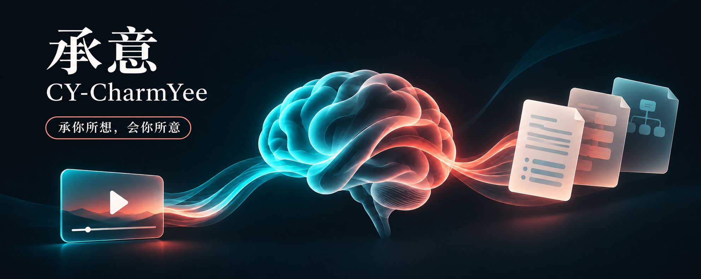
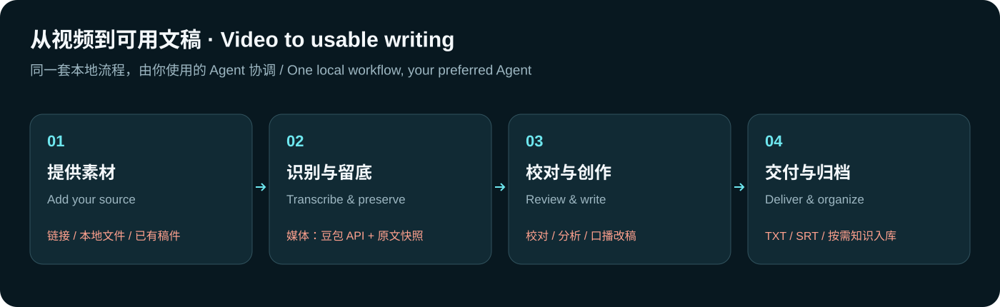
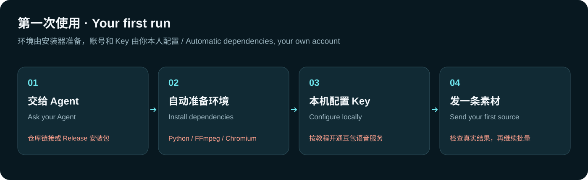
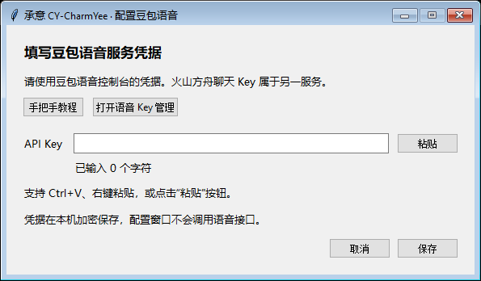

<div align="center">
  
  <h1>承意 · CY-CharmYee</h1>
  <p>承你所想，会你所意。</p>
  <p>Build a personal knowledge base through conversation, and turn your material, ideas, and creative work into a second brain.</p>
  <p><a href="README.md">中文</a> · English</p>
</div>

[](https://github.com/ScarfaceAI/CY-CharmYee/actions/workflows/check.yml)
[](https://github.com/ScarfaceAI/CY-CharmYee/blob/main/LICENSE)
[](https://github.com/ScarfaceAI/CY-CharmYee/releases/latest)

CY-CharmYee is a Windows-local suite of Skills for personal knowledge and media creation. Through a short conversation, your Agent can learn your stated background, goals, and collaboration preferences, then create or connect a knowledge base. You can also give it links, videos, or existing text for transcription, proofreading, analysis, and rewriting. Once enabled, the knowledge workflow retrieves relevant material, preserves useful outcomes, and develops related topics within the scope you choose.

A second brain starts with practical work: keeping the information you explicitly provide, preserving originals and sources, and making completed work useful again. The knowledge base is optional. Existing text needs no speech setup; media transcription uses your own Doubao Speech API.

> **1.6.0: 承意 · CY-CharmYee.** The brand and all 7 Skill entries share the new naming, with an optional personal knowledge base, conversational profiles, and scoped collection. Existing media and recovery workflows remain available. The first migration from the old brand requires running the new installer once. See the [1.6.0 release notes](docs/releases/v1.6.0.md), [brand migration](references/brand-migration.en.md), and [recovery and reuse](references/continuation.en.md).

The suite shares one installation, configuration, workspace, and update process. Tell your Agent what you need, or select an entry directly:

| Display name | Skill ID | Purpose |
|---|---|---|
| **CY-CharmYee** | `cy-charmyee` | Combined requests, configuration, migration, and maintenance. |
| **CY-vault** | `cy-vault` | Personal knowledge setup, profiles, creative and learning modules, and opted-in collection. |
| **CY-transcribe** | `cy-transcribe` | Media transcription, proofreading, subtitles, and exports. |
| **CY-analyze** | `cy-analyze` | Content and creator analysis. |
| **CY-download** | `cy-download` | Creator-profile videos and published captions. |
| **CY-write** | `cy-write` | Spoken-script rewriting, polishing, and shortening. |
| **CY-knowledge** | `cy-knowledge` | Source archiving and topic compilation. |

Display names use `CY-xxxx`; host-facing Skill IDs, directories, and invocation names use lowercase `cy-xxxx`. Child Skills need no separate configuration. Automatic discovery depends on the host Agent. See [suite routing](references/suite.en.md).



## What it does

- **Set up a personal knowledge base:** start with a brief profile conversation, add creative or learning modules when useful, or connect an existing library while preserving its rules and canonical profile.
- **Build knowledge during real work:** retrieve relevant context, preserve useful outcomes, and update related topics within the enabled scope. Skip questions, pause collection, or exclude a task from saving. Failed writes remain available to resume.
- **Transcribe:** Douyin post links, shared text, creator profiles, link lists, and local audio or video.
- **Preserve and proofread:** keep the machine transcript and existing source media unchanged, save a separate reviewed version, and read the whole text before checking names, numbers, and other uncertainties using the Agent's available image and audio tools.
- **Analyze and adapt:** summarize, analyze, shorten, or write spoken scripts without overwriting the source.
- **Analyze a creator or download their videos**: discover accessible videos and image posts page by page and analyze the transcript and actually viewed images over time. A separate mode downloads profile videos and captions without speech recognition. See the [creator workflow](references/creator.en.md).
- **Deliver batches:** isolate failures, combine completed results in the original order with their original numbers, and report failed items. A resumed task first reuses valid successful caches. An Agent can directly proofread an existing SRT and save a copy with its timecodes; exporting SRT from recognition requires segment timing data.
- **Archive and compile:** preserve originals, reviewed text, and derived work separately under the target library's rules, either on request or within an enabled collection scope. Creating a library does not scan or import previous tasks automatically.

Try asking your Agent:

> Help me set up a personal knowledge base. Start with the most useful questions so you can understand my work and help with future content.

> Continue our last learning task. Use my existing notes for a review and save the progress we confirm today.

> Transcribe this Douyin link, check the names and numbers, and give me the transcript only. Do not add it to a knowledge base: [link]

> Turn these videos into natural spoken scripts, one paragraph each, and combine them in order into a TXT file: [links]

> Transcribe the 10 latest posts on this creator profile and flag uncertain words: [profile link]

> Analyze all accessible posts on this creator profile and explain how the topics and content changed over time: [profile link]

> Analyze only the titles and captions on this profile and identify recurring topics: [profile link]

> Download this creator's videos and published captions at the best available quality: [profile link]

> Shorten this existing transcript into a spoken script while keeping its opening hook: [file path]

> Proofread this SRT and preserve its timecodes: [file path]

> Archive these originals and reviewed transcripts, then compile a topic page: [material]

At installation or first use, the Agent introduces the capabilities, examples, outputs, and speech-setup needs in chat, then continues your current task. You do not need to memorize commands. If you provide only a link without a goal, it asks one key question. Analysis starts with findings, examples, and coverage in chat; transcription or rewriting starts with readable text or a clearly marked excerpt before the file link. See the [first-use guide](references/onboarding.en.md).

## Start a personal knowledge base

Ask your Agent to create a personal knowledge base or connect an existing one. **CY-vault** first establishes its location and scope, reuses existing information, and asks only for useful missing details. Once the basic profile is sufficient, work begins; creative and learning modules can be added as relevant tasks arise.

A new library starts with source material, knowledge topics, and a personal profile. Other directories are added as needed. An existing library keeps its structure, rules, and profile entry. Enabled modules use relevant context and preserve task outcomes without requiring another archiving request each time. You can skip questions, pause collection, or keep a particular task unsaved. See the [personal knowledge guide](references/personal-vault.en.md).

Choose the suite workspace alone or everyday chats in the selected Agent. Configuring an instruction entry and verifying that a new chat actually reads it are separate checks; host behavior must be verified in a real session.

## Install

You need **Windows, an internet connection, and an Agent that can access local files and a terminal**. Python does not need to be installed in advance. Media transcription also requires your own Doubao Speech account and API key; usage is subject to the provider's terms and your account's pricing.

### Ask an Agent to install it

Send the following to your Agent. It can get a CY-CharmYee package from the [official Releases](https://github.com/ScarfaceAI/CY-CharmYee/releases/latest) or use a source directory you provide:

```text
Please install and enable CY-CharmYee (Skill ID: cy-charmyee) and its child Skills on my Windows computer. Get its installation ZIP and matching SHA-256 from https://github.com/ScarfaceAI/CY-CharmYee/releases/latest, or use the source root I provide; verify that bundle.json identifies cy-charmyee. Read INSTALL.md, explain the capabilities and speech-setup needs in chat first, then verify the package, handle installation and dependency setup, and load the installed SKILL.md in this conversation. Reuse my registered workspace rather than creating separate tasks or credentials; run the new installer for the first migration from dyb. I will enter my Doubao Speech API key in the local configuration window; do not ask me to paste it into chat. Douyin login is not a prerequisite for installation; open a visible Douyin browser only when I explicitly request login, verification, or interface troubleshooting.
```

### Install it yourself

1. Download `cy-charmyee-windows-v<version>.zip` and its checksum file from the [official Releases](https://github.com/ScarfaceAI/CY-CharmYee/releases/latest), verify SHA-256, and extract it; alternatively, use the repository source root. From 1.6.0, the archive root and product ID are both `cy-charmyee`. Historical `dyb-*` packages keep their original names.
2. Double-click `install.cmd`. The installer attempts to prepare Python, dependencies, FFmpeg, and the browser environment.
3. Ask your Agent to read the installed `SKILL.md`, then send it your material and instructions. On first use, it introduces the capabilities and checks local readiness.
4. Configure your Doubao Speech API key when you need media transcription; setup does not open the key window by default. Existing-text work, personal knowledge, and independent profile video downloads need no speech key. Configure a knowledge base when you choose to enable it.

For installation stages, options, setup, and troubleshooting, see the [English getting-started guide](docs/getting-started.en.md) and [INSTALL.md](INSTALL.md).

### Upgrade an existing installation

**Switching from `dyb-douyinbrain` to CY-CharmYee 1.6.0 requires running the new installer once.** Download and verify a CY-CharmYee package, then have your Agent run its `scripts/install.ps1` with the same Windows account and custom installation arguments. The installer discovers existing registrations, reuses a single workspace automatically, and requests a selection if several differ. The old updater pins the previous package name and product identity: even versions 1.1.0–1.5.0 cannot make this cross-brand transition through their old `update --apply`. After a local `doctor` and a functional check, reread the installed `SKILL.md` or start a new conversation.

The old `dyb-douyinbrain`, `dyb-*`, and earlier `douyin-brain` names serve as compatibility entries. Migration preserves the registered workspace, credentials, and tasks, and backs up replaced program files and settings. Multiple different workspaces are listed for selection and are never merged automatically. See the [installation and migration guide](INSTALL.md).

After migration, new tasks check for the latest stable release and notify you without installing it automatically. Say “Use CY-CharmYee to update itself,” or invoke `$cy-charmyee update` in a compatible host. The Agent verifies the official package and updates only when you explicitly request it. A failed network check does not block the original task; media downloads and cloud speech recognition still require network access. See the [upgrade steps](docs/releasing.en.md#upgrading-an-existing-installation).

## Configure Doubao Speech



1. Sign in to [Volcengine](https://signin.volcengine.com/auth/signup) and open the [speech service activation page](https://console.volcengine.com/speech/new/setting/activate?projectName=default).
2. In the selected project, enable **recording file recognition, fast version** and review the available quota and billing terms.
3. Create or copy a speech API key in the **same project** from the [API key page](https://console.volcengine.com/speech/new/setting/apikeys?projectName=default).
4. Open `配置豆包.cmd` and paste the key into the local configuration window; do not send the key in chat.
5. Use a short recording for a real transcription to check service access. Recognition may use quota or incur charges.

The links open the `default` project; switch projects if appropriate. A speech key is different from a Volcengine Ark chat-model key. See the [step-by-step Chinese guide](references/doubao-setup.md) for legacy credentials and troubleshooting.

The actual local configuration dialog, with no credentials entered:



The dialog's tutorial button opens a native local guide window without relying on the default browser. A separate offline HTML guide is also included. The desktop dialog and native guide are in Chinese; the [English getting-started guide](docs/getting-started.en.md) explains every step.

## Agent compatibility

The project provides installation adapters for these Agents; every entry uses the same core engine. The Skill uses the common `SKILL.md` format, but automatic discovery depends on each Agent's configuration and version. Real end-to-end sessions have not yet been individually verified across all Agents in this version.

| Agent or mode | `-Agent` | Notes |
|---|---|---|
| Automatic | `auto` | Uses shared `.agents/skills`; attempts a Claude bridge when detected and preserves an existing independent install. |
| Shared skills | `shared` | For Agents that read the shared directory. |
| DeepSeek Harness | `deepseek` | Installation adapter provided. |
| Codex | `codex` | Installation adapter provided. |
| Claude Code | `claude` | Installation adapter provided. |
| Gemini CLI | `gemini` | Installation adapter provided. |
| Cursor | `cursor` | Installation adapter provided. |
| OpenCode | `opencode` | Installation adapter provided. |
| All or custom | `all` / `custom` | Use the shared directory and attempt a Claude bridge, or choose a directory with `-SkillsRoot`. |

Other compatible Agents with local file and terminal access can read `SKILL.md` and run the bundled entry point. See [INSTALL.md](INSTALL.md) for options.

## Data, network access, and limits

- For a fresh install, the default workspace is `cy-charmyee` under Windows Documents, and local settings are in `%LOCALAPPDATA%\cy-charmyee\settings.json`. Migration reuses registered locations without moving tasks or credentials just to match the new name. Credentials are encrypted using the current Windows user's DPAPI and stored in the workspace. Installation packages exclude your keys, browser login state, and task history.
- Acquiring media accesses Douyin; recognition sends audio to Doubao Speech. Installing dependencies also requires network downloads. Use material in accordance with applicable permissions and service terms.
- For a single public video, acquisition first tries the ordinary HTTP share page, then a headless page without saved login state. It may use an existing dedicated browser state if needed; yt-dlp remains a fallback for individual posts. Routine acquisition runs in the background without stealing focus, using Computer Use, automatically logging in, solving CAPTCHA, or using a third-party paid parser. The 1.3.0 local candidate was tested on a fixed sample through anonymous acquisition, live Doubao recognition, and visual review; acquisition did not succeed for every item and audio was not listened to. See the [previous verification record](docs/verification/v1.3.0.md); see the [1.4.0 release notes](docs/releases/v1.4.0.md) for the formal version and its verification scope.
- Site changes or access restrictions can prevent acquisition; failures report the actual cause. Login or verification is reported as required only when a visible blocking container explicitly requests it; words in a title or post and a normal login button do not prove a block. A visible dedicated browser opens only when you explicitly request login, verification, or interface troubleshooting; you complete any login or CAPTCHA locally.
- Creator profiles depend on pagination and platform responses. A run that does not reach the end is reported as incomplete rather than presented as the full profile.
- Creator analysis previews the number of new paid recognition items, known duration, and unknowns before you authorize a batch. No cost is estimated when the applicable unit price is unknown. Titles/captions-only analysis makes no recognition calls. Image posts are included in analysis; the independent download mode handles videos only. Visual review depends on the Agent's actual ability to inspect images.
- `doctor` checks local dependencies and credential presence only; it does not log in to Douyin or validate cloud speech permissions. `awaiting_api` still allows existing-text work, while transcription needs speech configuration.
- Transcription can contain mistakes, particularly names, numbers, and specialist terms. The Agent checks uncertainties using its actual image and audio tools and records the evidence used; sampled frames are not OCR, and preparing material is not a completed review. Check failed or unknown paid requests before asking for a retry.

## License and contributions

Project-owned code is released by [ScarfaceAI](https://github.com/ScarfaceAI) under the [MIT License](LICENSE). Third-party components have their own licenses; see [THIRD_PARTY_NOTICES.md](THIRD_PARTY_NOTICES.md). For provenance and history, see [references/sources.md](references/sources.md). See [CONTRIBUTING.md](CONTRIBUTING.md), the [maintenance and release guide](docs/releasing.en.md), and [SECURITY.md](SECURITY.md).
