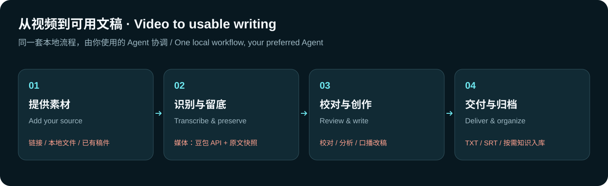
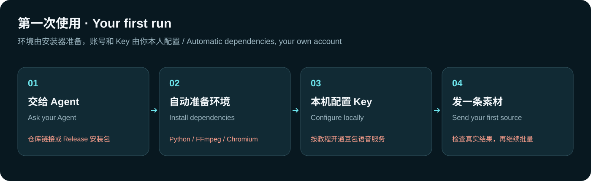
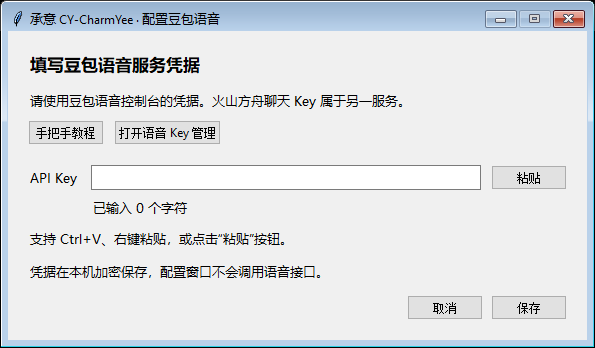
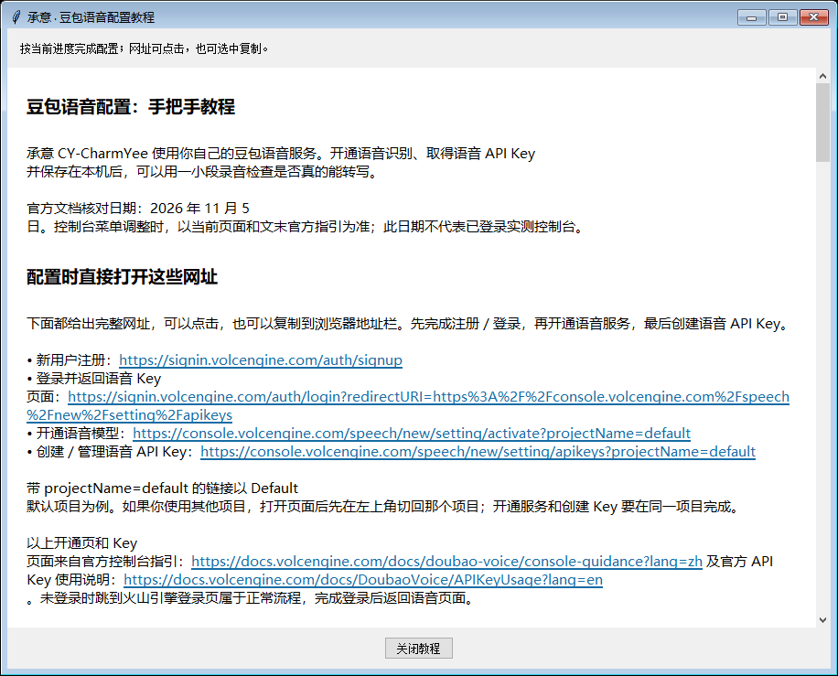

<div align="center">
  
  <h1>承意 · CY-CharmYee</h1>
  <p>承你所想，会你所意。</p>
  <p>用对话建立个人知识库，把资料、想法和创作成果积累成自己的第二大脑。</p>
  <p>中文 · <a href="README.en.md">English</a></p>
</div>

[](https://github.com/ScarfaceAI/CY-CharmYee/actions/workflows/check.yml)
[](https://github.com/ScarfaceAI/CY-CharmYee/blob/main/LICENSE)
[](https://github.com/ScarfaceAI/CY-CharmYee/releases/latest)

承意是一套在 Windows 本地运行的个人知识库与媒体创作 Skill。你可以让 Agent 通过简短对话了解你的背景、目标和协作偏好，建立或接入知识库；也可以直接交给它链接、视频或文稿，完成转写、校对、分析和改写。开启知识库后，它会在你选择的范围内查找已有资料、保存有价值的成果，并把相关内容整理成主题。

“第二大脑”从具体的事情做起：记住你明确告诉它的资料，保留原文与来源，让完成过的工作可以继续使用。知识库可选，已有文字不需要语音配置；音视频转写使用你自己的豆包语音 API。

> **1.6.0：承意 · CY-CharmYee。** 品牌和 7 个 Skill 入口统一命名，新增可选个人知识库、对话建档与主动积累，保留既有媒体处理和恢复流程。从旧品牌首次迁移需要运行一次新安装器。详见 [1.6.0 版本说明](docs/releases/v1.6.0.md)、[品牌迁移](references/brand-migration.md)及[恢复与复用](references/continuation.md)。

承意共用一套安装、配置、工作目录和更新。平时直接说目标即可，也可指定以下入口：

| 名称 | Skill ID | 用途 |
|---|---|---|
| **CY-CharmYee** | `cy-charmyee` | 组合需求、配置、迁移和维护。 |
| **CY-vault** | `cy-vault` | 个人知识库、对话建档、创作与学习模块、主动积累。 |
| **CY-transcribe** | `cy-transcribe` | 音视频转写、校对、字幕和导出。 |
| **CY-analyze** | `cy-analyze` | 内容与博主分析。 |
| **CY-download** | `cy-download` | 主页视频与发布文案下载。 |
| **CY-write** | `cy-write` | 口播改写、润色与压缩。 |
| **CY-knowledge** | `cy-knowledge` | 材料归档与知识主题编译。 |

显示名称使用 `CY-xxxx`，宿主读取的 Skill ID、目录和调用名称使用小写 `cy-xxxx`。子 Skill 无需分别配置，具体能否自动发现取决于宿主 Agent。详见[套件路由](references/suite.md)。



## 能做什么

- **建立个人知识库**：先通过简短对话建立基础资料，再按实际任务增配创作或学习模块；支持接入已有库，保留原有规则和权威档案。
- **边做边积累**：在已开启的范围内主动查资料、保存成果、更新相关主题；可以跳过问题、暂停，或说“这次不保存”。写入失败保留待处理项，之后可以续办。
- **视频转文字**：处理抖音作品链接、分享文案、作者主页、链接清单和本地音视频；使用豆包语音识别。
- **校对留底**：保留机器识别原文，不覆盖已有原始素材，另存校对稿；先通读全文，再按 Agent 实际的看图、听音能力核查数字、专名等疑点，标明依据或不确定之处。
- **分析和改口播**：总结、分析、压缩、润色或改成口播稿，原稿和改写稿分别保存。
- **博主全量分析与视频下载**：按主页逐页整理可访问的视频和图文，结合口播与实际查看的画面按时间分析；也可独立批量下载主页视频及发布文案，不调用语音识别。详见[博主任务指南](references/creator.md)。
- **批量交付**：逐条隔离失败，按原顺序和原序号合并已完成内容，说明失败项；续跑时先复用有效成功缓存。已有 SRT 可让 Agent 直接校对并另存，保留时间码；从识别结果导出 SRT 需要已有分句时间。
- **归档与编译**：按明确要求或已经开启的自动积累范围，将原文、校对稿和衍生成果分别保存，并按目标库规则整理主题；新建库不会自动扫描或收录历史任务。

安装后可以直接跟 Agent 说：

> 帮我建立个人知识库。先问最有用的几个问题，让你了解我，以后做内容时用得上。

> 接着上次的学习任务，用已有资料帮我复盘，把这次确认的进度记下来。

> 把这个抖音链接转成文字，校对人名和数字，只交逐字稿，不入库：［链接］

> 把这几条视频分别改成自然口播，每条一段，按原顺序合成一个 TXT：［链接清单］

> 转写这个作者主页最近 10 条视频，标出不确定的地方：［主页链接］

> 分析这个博主可访问的全部作品，按时间讲清选题和内容怎么变化：［主页链接］

> 只分析这个主页的标题和发布文案，看看常用选题：［主页链接］

> 批量下载这个主页的视频和发布文案，优先可获取的最高画质：［主页链接］

> 把这份已有文稿整理成更精简的口播稿，保留开头钩子：［文件路径］

> 校对这个 SRT 的文字，保留原来的时间码：［文件路径］

> 把这批原文和校对稿存入知识库，并编译成主题页：［素材］

安装或首次使用时，Agent 会先在聊天中介绍全部功能、示例、产出及语音配置需求，再按你当前的目标继续；无需记命令。只发链接而没说用途时，它会问一个关键问题。分析会先在聊天中给结论、例子和范围，转写或改稿会先给正文或标明节选，再附完整文件。详见[首次介绍](references/onboarding.md)。

## 个人知识库怎么开始

对 Agent 说“帮我建立个人知识库”或“接入现有知识库”。**CY-vault** 先确定使用位置和范围，再利用已有资料、补问必要信息。基础资料够用就开始做事，之后遇到创作或学习任务再逐步增配。

新库先建素材、知识主题和个人档案三层，用到其他目录时再增加。已有库沿用原目录、规则和档案入口。你选择开启的模块会主动使用资料并保存任务成果，无需每次再说“入库”；你仍可跳过提问、暂停积累，或让某次任务不保存。详见[个人知识库指南](references/personal-vault.md)。

可以仅在本套件工作区使用，也可以接入所选 Agent 的日常聊天。入口配置成功与新聊天实际读取是两项检查，宿主效果以真实会话为准。

## 安装

**需要 Windows、可联网的环境，以及一个有本地文件和终端能力的 Agent。** 不需要提前安装 Python。媒体转写还需要你自己的豆包语音服务账号和 API Key；实际费用以服务提供方和你的账户为准。

### 方式一：交给 Agent

把下面这段发给 Agent。它可以从[官方 Release](https://github.com/ScarfaceAI/CY-CharmYee/releases/latest)获取承意安装包，也可以使用你提供的源码目录：

```text
请在我的 Windows 电脑安装并启用承意 CY-CharmYee（Skill ID：cy-charmyee）及其子 Skill。从 https://github.com/ScarfaceAI/CY-CharmYee/releases/latest 获取承意安装 ZIP 和对应 SHA-256，或使用我提供的源码根目录；核对 bundle.json 的 name 为 cy-charmyee。阅读 INSTALL.md，先在聊天中介绍功能与语音配置需求，再自动完成校验、安装和依赖配置，并在当前对话加载安装后的 SKILL.md。沿用已有工作区，不另建一套任务或凭据；旧 dyb 版本首次迁移请运行新安装器。豆包语音 Key 由我在本机窗口填写，不要让我把 Key 发到聊天里。抖音登录不是安装前置；只有我明确要求登录、验证或界面排障时才打开可见的抖音浏览器。
```

### 方式二：自己安装

1. 从[官方 Release](https://github.com/ScarfaceAI/CY-CharmYee/releases/latest)下载 `cy-charmyee-windows-v<版本>.zip` 和对应校验文件，核验 SHA-256 后解压；也可使用仓库源码根目录。1.6.0 起的包内根目录和产品 ID 均为 `cy-charmyee`，历史 `dyb-*` 包保留原名。
2. 双击 `install.cmd`。安装器会尝试自动准备 Python、运行依赖、FFmpeg 和浏览器环境。
3. 让 Agent 读取安装后的 `SKILL.md`，然后直接发送素材和要求。首次使用时它会介绍功能并检查本机状态。
4. 需要转写音视频时再配置自己的豆包语音 API Key；默认不弹配置窗口。处理已有文稿、个人知识库或独立下载主页视频不需要语音 Key。知识库在你选择开启时配置。

安装参数、默认目录和状态说明见[安装指南](INSTALL.md)。

### 更新已有安装

**从 `dyb-douyinbrain` 切换到承意 1.6.0，需要运行一次新安装器。** 下载并校验承意安装包后，让 Agent 使用其中的 `scripts/install.ps1`，沿用原 Windows 用户及自定义安装参数。安装器会查找已有登记；找到单一工作区时自动复用，存在多个时再选择。旧版更新器固定校验旧包名与产品标识，即使是已有更新功能的 1.1.0–1.5.0，也不能直接通过旧 `update --apply` 跨品牌升级。完成本地 `doctor` 与功能检查后，重新读取安装后的 `SKILL.md`，或开启新会话。

旧名称 `dyb-douyinbrain`、`dyb-*` 和更早的 `douyin-brain` 用作兼容入口。迁移保留已登记的工作目录、Key 和任务，并备份被替换的程序与配置；发现多个不同工作目录时列出候选项，不会自动合并。详见[安装与迁移说明](INSTALL.md)。

完成迁移后，新任务会检查最新正式版，有新版时提醒，不会擅自安装。需要更新时可以说“使用承意更新自己”，或在支持的宿主中调用 `$cy-charmyee 更新`。Agent 会在你明确要求后验证官方包并更新。检查暂时无法联网时不会阻断原任务；下载素材和调用云语音仍需要网络。详见[升级步骤](docs/RELEASING.md#已有用户如何升级)。

## 配置豆包语音



1. 注册或登录[火山引擎](https://signin.volcengine.com/auth/signup)，进入[语音服务开通页面](https://console.volcengine.com/speech/new/setting/activate?projectName=default)。
2. 在选定项目中开通「录音文件识别极速版」，查看实际额度和计费条件。
3. 在**同一个项目**的[语音 API Key 管理页面](https://console.volcengine.com/speech/new/setting/apikeys?projectName=default)创建或复制 Key。
4. 双击 `配置豆包.cmd` 打开本机配置窗口并粘贴 Key；不用把 Key 发给 Agent。
5. 选择一小段本地录音完成真实转写，确认服务可用。真实识别可能消耗额度或产生费用。

页面链接默认进入 `default` 项目；如果服务在其他项目，先切换到实际项目。语音 Key 不是火山方舟聊天模型的 Key。更详细的步骤、旧版凭据和排障见[豆包语音配置教程](references/doubao-setup.md)。

配置窗口与本机教程的实际界面（未填写任何凭据）。点击配置窗口中的「手把手教程」可直接打开本机教程窗口，不依赖默认浏览器；安装目录还提供离线 HTML 版本。



<details><summary>查看本机配置教程窗口</summary>



</details>

## Agent 兼容

项目提供以下安装适配；所有入口使用同一个核心引擎。Skill 使用通用 `SKILL.md` 格式，但自动发现方式取决于各 Agent 的配置和版本。本版本的跨 Agent 真实会话尚未逐一验证。

| Agent 或方式 | 安装选择 | 说明 |
|---|---|---|
| 自动选择 | `auto` | 默认共享 `.agents/skills`；检测到已有 Claude 配置时尝试桥接，保留同名独立安装。 |
| 共享 Skill 目录 | `shared` | 适合读取共享目录的 Agent。 |
| DeepSeek Harness | `deepseek` | 提供安装适配。 |
| Codex | `codex` | 提供安装适配。 |
| Claude Code | `claude` | 提供安装适配。 |
| Gemini CLI | `gemini` | 提供安装适配。 |
| Cursor | `cursor` | 提供安装适配。 |
| OpenCode | `opencode` | 提供安装适配。 |
| 全部或自定义 | `all`／`custom` | 使用共享目录并尝试 Claude 桥接，或通过 `-SkillsRoot` 指定目录。 |

有本地文件和终端能力的其他兼容 Agent，可读取 `SKILL.md` 并运行随包入口。使用方法和 `-Agent` 示例见 [INSTALL.md](INSTALL.md)。

## 数据、网络与限制

- 新安装默认工作数据在 Windows「文档」下的 `cy-charmyee`；本机设置在 `%LOCALAPPDATA%\cy-charmyee\settings.json`。迁移沿用已有登记的位置，不因改名搬走任务或凭据。凭据使用当前 Windows 用户的 DPAPI 加密保存在工作目录。安装包不包含你的 Key、登录状态或历史任务。
- 下载抖音素材时会访问抖音；识别时音频会发送给豆包语音服务。安装依赖时需要联网下载相应组件。请根据素材权限和服务条款选择处理内容。
- 单条公开视频先尝试普通 HTTP 分享页，再通过无登录态的无头页面获取；必要时可尝试本机已有的专用浏览器状态，单条作品也保留 yt-dlp 回退。常规获取在后台运行，不弹窗抢焦点，不使用 Computer Use，也不自动登录、处理验证码或使用第三方付费解析。1.3.0 本地候选曾对固定样本实测匿名获取、真实豆包识别和画面校对，但并非每条都能获取，且未做听音核对；详见[上一轮验收](docs/verification/v1.3.0.md)，正式版本的功能和验证范围见 [1.4.0 版本说明](docs/releases/v1.4.0.md)。
- 页面变化或访问限制可能影响获取，失败时按实际原因报告；只有可见阻挡容器明确提示才报告需要登录或验证，正文、标题中的相关词和普通登录按钮本身不能证明被阻挡。只有你明确要求登录、验证或界面排障时才打开可见的专用浏览器，登录和验证码由你在本机完成。
- 作者主页受分页和平台返回结果影响；未能翻到末尾时会报告不完整，不能把已获取部分当成全部作品。
- 博主分析的新增付费识别先展示当前批次数量、已知时长和未知项，由你确认后才提交；实际单价不明时不估算费用。只分析标题／发布文案不调用识别。图文只进入分析，独立下载入口只处理视频；视觉核对取决于当前 Agent 的实际看图能力。
- `doctor` 只检查本机依赖和凭据是否存在，不登录抖音，也不验证豆包云端权限。安装显示 `awaiting_api` 时仍可处理已有文字；转写需要之后完成语音配置。
- 识别结果可能有错，尤其是人名、数字和专业词。Agent 按当前可用的看图、听音工具核查并记录实际依据；抽样帧不是 OCR，准备材料不等于已校对。失败或结果未知的付费请求需先核对，再按用户要求重试。

## 开源与贡献

承意自有代码由 [ScarfaceAI](https://github.com/ScarfaceAI) 以 [MIT License](LICENSE) 发布。安装时使用的第三方组件遵循各自许可证，见 [THIRD_PARTY_NOTICES.md](THIRD_PARTY_NOTICES.md)；来源与历史见 [references/sources.md](references/sources.md)。欢迎阅读[贡献指南](CONTRIBUTING.md)、[维护与发布指南](docs/RELEASING.md)和[安全说明](SECURITY.md)。
